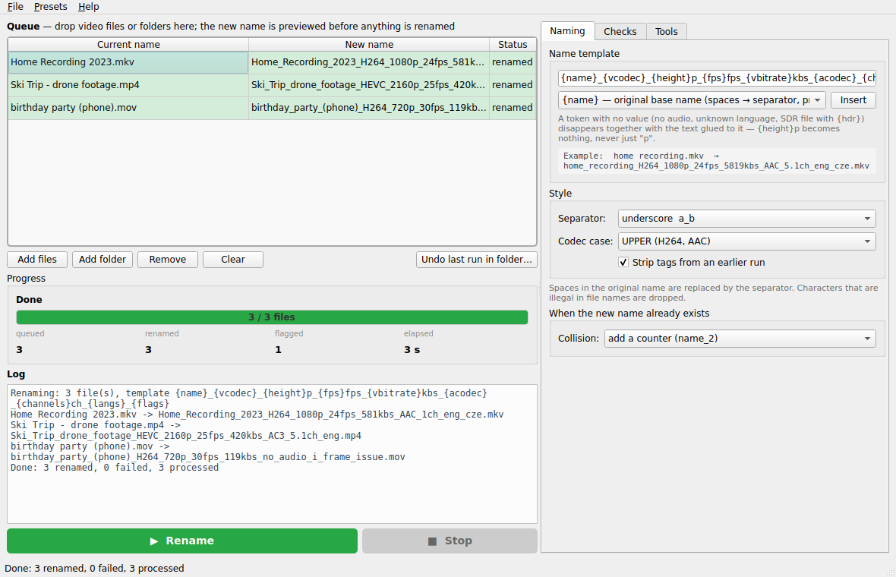

# nameer

Rename video files after what is actually inside them — codec, resolution, frame rate, bitrate, audio, languages —
so a folder listing tells you which files need attention without opening a single one.



```
home recording.mkv   →   home_recording_H264_1080p_24fps_5819kbs_AAC_5.1ch_eng_cze.mkv
```

## What it does

1. Drop files or folders on the window (or **Add files / Add folder**). Sub-folders are included.
2. Every file is probed with **ffprobe** in the background and the **new name is previewed** in the queue before
   anything is touched. Change the template or style and the previews update live.
3. Press **Rename**. Files are renamed in place; an `nameer-undo.log` is written next to them so a run can be
   reverted (**Undo last run in folder…**), and names that already exist get a counter instead of being overwritten.

The name is built from a **template** you control:

```
{name}_{vcodec}_{height}p_{fps}fps_{vbitrate}kbs_{acodec}_{channels}ch_{langs}_{flags}
```

| Token | Value | Token | Value |
|---|---|---|---|
| `{name}` | original name, spaces → separator, earlier nameer tags stripped | `{acodec}` / `{acodecs}` | first / all audio codecs |
| `{vcodec}` | H264, HEVC, AV1, VP9 … | `{channels}` | 2, 5.1, 7.1 |
| `{height}` / `{width}` | 1080 / 1920 | `{abitrate}` | audio kb/s |
| `{fps}` | rounded frame rate | `{langs}` / `{subs}` | audio / subtitle languages |
| `{vbitrate}` | video kb/s (whole-file bitrate minus audio when the container hides it — MKV) | `{duration}` / `{size}` | 1h42m / 4.2GB |
| `{hdr}` / `{bitdepth}` | HDR, DV, SDR / 8bit, 10bit | `{container}` | mkv, mp4 |
| `{flags}` | `i_frame_issue`, `no_audio`, `no_video` | | |

A token with no value disappears together with the text glued to it: a file without audio renders
`…_24fps_no_audio.mp4`, never `…_24fps_ch_.mp4`. Re-running nameer on an already-named file recognises its own tags
and does not stack them twice.

The **I-frame check** decodes the first 30 s and flags files with fewer than 3 key frames (broken or badly remuxed
files) — switch it off in *Checks* for fast runs over large collections.

## Install

**Release binaries** (no Python needed): download the archive for your OS from
[Releases](https://github.com/hclivess/nameer/releases), unpack, run `nameer`.

| OS | File |
|---|---|
| Windows x64 | `nameer-<version>-windows-x64.zip` |
| Linux x64 | `nameer-<version>-linux-x64.tar.gz` |
| macOS arm64 | `nameer-<version>-macos-arm64.tar.gz` |

**ffprobe** (part of FFmpeg) must be on `PATH` or placed next to the `nameer` executable — the *Tools* tab shows
whether it was found and lets you point at a custom binary. `winget install ffmpeg` / `brew install ffmpeg` /
`apt install ffmpeg`.

**From source:** `pip install -r requirements.txt` then `python main.py` (or `run.cmd` / `run.sh`). Python 3.10+.

## Settings

| Tab | Setting | What it does |
|---|---|---|
| Naming | Template | Tokens in braces are replaced; everything else stays literal. *Insert* adds a token at the cursor. |
| | Separator | `_` `.` `-` or space — replaces spaces in the original name and joins the tags. |
| | Codec case | `H264`/`AAC`, `h264`/`aac`, or exactly what ffprobe reports. |
| | Strip tags from an earlier run | Peels a trailing run of nameer tags off the original name (needs at least one unmistakable tag such as `1080p` or `24fps` so real short words survive). |
| | Collision | Counter (`name_2`), skip, or overwrite (asks first). |
| Checks | I-frame check | Seconds to inspect and the minimum count before `i_frame_issue` is flagged. |
| | Dry run | Probe and log, rename nothing. |
| | Undo log | Write `nameer-undo.log` next to renamed files. |
| Tools | ffprobe | Status, version, custom path, re-check. |

**Presets** menu: *Classic*, *Short*, *Scene style* (dots, lower case, HDR + bit depth), *Archive* (everything incl.
duration and size); save/load/import/export your own; save the current settings as defaults.

## CLI

```
python nameer.py [-n] [-t TEMPLATE] [-s SEP] [--case upper|lower|keep] [--no-iframes] files-or-folders…
python nameer.py --undo FOLDER      # revert the last run in FOLDER
python nameer.py --tokens           # list template tokens
```

The CLI lives in `nameer.py`, which imports nothing from Qt. In the release archive use `nameer` itself only for the
GUI; for scripting run `nameer.py` from the source tree.

## Tips

| Symptom | Setting |
|---|---|
| Bitrate looks like the whole file's bitrate | MKV does not store per-stream bitrates; nameer subtracts the audio bitrate from the file bitrate. Remux to MP4 if you need exact numbers. |
| Probing is slow on a network share | Turn off the I-frame check — it is the only part that decodes video. |
| A name lost a real word such as *"be"* | Turn off *Strip tags from an earlier run* for that folder. |
| Language shows as nothing | The stream is tagged `und`; tag it (mkvpropedit) or drop `{langs}`. |

## Build

`pip install -r requirements.txt pyinstaller && python build.py` → `dist/nameer-<version>-<os>-<arch>.zip|tar.gz`.
Tag `v<APP_VERSION>` (from `config.py`) and CI builds all three OSes, runs the unit tests and a headless rename of a
generated video against the frozen Linux binary, and attaches the archives to the release.

## Changes in 2.0

- **Rewritten as a PySide6 desktop app** with live name previews, presets, dry run, undo log, drag & drop of folders.
  The previous version was a drag-onto-exe script with no UI, no preview, and no way back.
- **Template-based names** — choose and order the tags; 18 tokens including HDR, bit depth, duration and size.
- Fixes: 23.976 fps is `24fps` (was `23fps`); MKV bitrate no longer missing; `eval()` on ffprobe output removed;
  languages tagged `und` no longer appear; attached cover images are not treated as the video stream;
  re-running no longer stacks tags; illegal filename characters dropped; `5.1ch` for 6-channel audio.
- `ffprobe.7z` is no longer bundled in the repository — install FFmpeg or put ffprobe next to the app.
- Standalone releases for Windows, Linux and macOS; CI self-test on the frozen binary.
- Not compatible with 1.x names only in one respect: the `_problem` suffix is now `i_frame_issue`.
